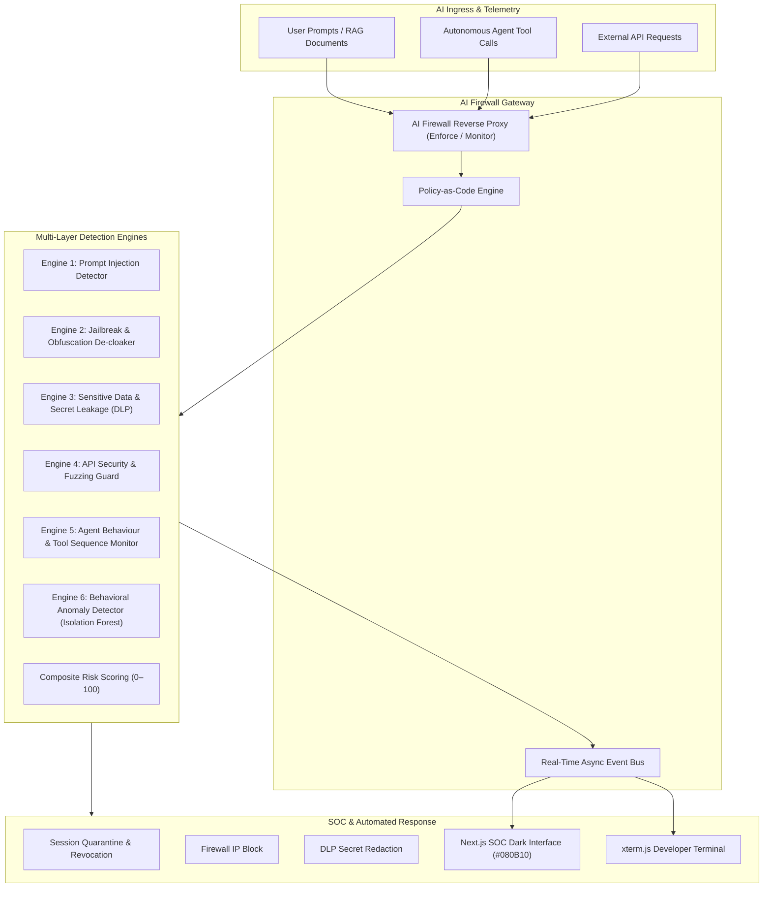

# AgentGuard — AI-Native Cybersecurity & Red Team SaaS Platform

> **Secure Your AI. Detect Every Threat.**
> Production-oriented AI application security, real-time LLM firewall proxy, autonomous agent monitoring, and authorized adversarial red-team benchmark suites.

---

## 1. Product Overview

AgentGuard is a cybersecurity SaaS platform engineered to protect modern AI architectures, Large Language Model applications, and autonomous agent runtimes against emerging attack vectors:
- **Direct & Indirect Prompt Injection** (ChatML tokens, delimiter hijacking, Markdown hidden directives)
- **Adversarial Persona Jailbreaks** (DAN personas, hypothetical framing, base64 / hex obfuscation)
- **Sensitive Data & Credential Exfiltration** (API secrets, private keys, Shannon entropy analysis, automated DLP masking)
- **API Security Flaws** (BOLA/IDOR probes, broken authentication headers, rate limit abuse, input mutations)
- **Agent Tool Hijacking & Privilege Escalation** (Prohibited sequence pairs, destructive command prevention)
- **Behavioral Traffic Anomalies** (Scikit-learn Isolation Forest + statistical z-score baseline anomaly scoring)

---

## 2. System Architecture



---

## 3. Core Security Engines

| Engine | File | Description & Capabilities |
|---|---|---|
| **Prompt Injection** | `backend/app/engines/prompt_injection.py` | Detects direct overrides, ChatML `<\|im_start\|>` delimiters, indirect document instructions, and system prompt extraction probes. |
| **Jailbreak Detection** | `backend/app/engines/jailbreak.py` | Detects DAN persona simulations, hypothetical evasions, instruction hierarchy manipulation, and Base64/ROT13 obfuscation. |
| **Sensitive Data Leakage** | `backend/app/engines/data_leakage.py` | Detects API keys (OpenAI, AWS, GitHub, Stripe, Slack), private keys, passwords, and PII with high-entropy token analysis and in-flight redaction. |
| **API Security** | `backend/app/engines/api_security.py` | Inspects BOLA indicators, broken authorization headers, SQLi tokens, directory traversal, and rapid rate-limit violations. |
| **Agent Behaviour Monitor** | `backend/app/engines/agent_monitor.py` | Enforces tool call whitelists, identifies prohibited sequence pairs (e.g. `read_credentials` -> `send_http`), and blocks destructive commands. |
| **ML Anomaly Detector** | `backend/app/engines/anomaly_detector.py` | Scikit-learn Isolation Forest model evaluating traffic feature vectors with automatic statistical z-score fallback. |
| **Composite Risk Scorer** | `backend/app/engines/risk_scorer.py` | Weighted composite score (0–100) factoring base severity (35%), confidence (25%), impact (20%), asset criticality (10%), and frequency (10%). |
| **AI Firewall Reverse Proxy** | `backend/app/engines/firewall_proxy.py` | Connects all engines into an active inspection layer supporting `enforce`, `monitor`, and `disabled` modes. |

---

## 4. SOC Frontend & Navigation Views

The web dashboard is built with Next.js, React, Tailwind CSS, xterm.js, and React Flow with a dark cybersecurity visual design (`#080B10` background, `#101722` navy panels, and `#39FF88` neon accents).

1. **Overview**: Security posture score (0–100), active detections, threat distribution breakdown, and 24h activity timeline.
2. **Live Threat Monitor**: Streaming security event feed with severity filters, search, forensic inspection drawer, and live simulation triggers.
3. **AI Firewall**: Mode switcher (`ENFORCE`, `MONITOR`, `DISABLED`), metrics (inspected, blocked, redacted), and interactive inspection playground.
4. **Vulnerability Scanner**: Authorized endpoint scanner and Feature 16 Credential Exposure Audit for scanning repositories and configs without storing raw secrets.
5. **Red Team Lab**: Automated adversarial benchmark suites (OWASP LLM01, LLM06, LLM08) and Feature 10 Security Regression Testing suite.
6. **API Security**: Monitored API inventory, BOLA risk detection, and controlled safe fuzz testing.
7. **Agent Behaviour**: Agent session roster, tool invocation sequence timeline, and interactive tool execution safety auditor.
8. **Attack Intelligence**: Global threat feed signatures and IP reputation enrichment lookup.
9. **Attack Graph**: Interactive React Flow topology mapping entrypoints, vulnerabilities, monitored AI models, agent tools, and crown-jewel assets.
10. **Incident Forensics**: Alert correlation engine grouping events into incidents with one-click automated response actions (Quarantine Session, Block IP, Rate Limit).
11. **ML Analytics**: Isolation Forest contamination factors, feature importance weights, and live model evaluation snapshot.
12. **Compliance Reports**: Standardized assessments mapped to OWASP LLM Top 10, OWASP API Security Top 10, and NIST AI RMF with JSON export.
13. **Integrations**: Slack, Splunk, SIEM log forwarder, PagerDuty, and LLM gateway connectors.
14. **Developer Terminal**: Interactive xterm.js shell with real backend CLI execution, autocomplete, and command history.
15. **Settings**: Organization details, RBAC roles, subscription tier simulation, and SHA-256 hashed API key management.

---

## 5. Developer Terminal & CLI Reference

Type commands directly into the integrated terminal or execute via API:

```bash
# Initialize AgentGuard configuration
agentguard init

# List registered projects and protected AI applications
agentguard project list

# Inspect AI Firewall status
agentguard firewall status

# Switch AI Firewall enforcement mode
agentguard firewall enable
agentguard firewall monitor

# Run automated security scans
agentguard scan --type full
agentguard scan --type prompt-injection
agentguard scan --type api-security
agentguard scan --type redteam

# Query live threat events and incidents
agentguard threats --severity critical
agentguard incidents list

# Execute security regression suite (checks for recurring vulnerabilities)
agentguard regression run

# Generate compliance report
agentguard report export
```

---

## 6. Quick Start & Execution

### Prerequisites
- Python 3.12+
- Node.js 20+ & npm

### Method 1: Local Development

#### 1. Start the Backend
```bash
# From workspace root
source .venv/bin/activate
cd backend
pip install -r requirements.txt

# Start FastAPI server on port 8000
python -m uvicorn app.main:app --host 0.0.0.0 --port 8000 --reload
```
The backend initializes the SQLite database, runs migrations, seeds enterprise demo data, and exposes the interactive OpenAPI documentation at `http://localhost:8000/docs`.

#### 2. Start the Frontend
```bash
# In a separate terminal
cd frontend
npm install
npm run dev
```
Open `http://localhost:3000` to access the AgentGuard SOC dashboard.

---

### Method 2: Docker Compose

Run both services in containers with a single command:
```bash
docker compose up --build
```
- Frontend: `http://localhost:3000`
- Backend API & Docs: `http://localhost:8000/docs`

---

## 7. Running Automated Test Suites

```bash
# Run detection engine unit tests
PYTHONPATH=backend pytest backend/tests/test_engines.py

# Run end-to-end API integration tests
PYTHONPATH=backend pytest backend/tests/test_api_integration.py
```
All tests validate detection accuracy, firewall blocking, DLP redaction, and terminal command execution.
