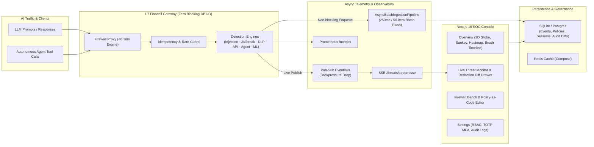

# AgentGuard — Real-Time AI Firewall, Threat SOC & Red Team Platform

> **A digital immune system for production LLM applications and autonomous agents.**
> Sub-millisecond prompt/response inspection, real-time SSE threat telemetry, interactive 3D attack topology, enterprise RBAC + TOTP MFA, and automated adversarial red-teaming.

[](https://fastapi.tiangolo.com)
[](https://nextjs.org)
[](https://www.typescriptlang.org)
[](https://docs.pmnd.rs/react-three-fiber)
[](backend/tests)

---

## Engineering Highlights & Measured Benchmarks

AgentGuard is architected for **low-latency inline enforcement** without sacrificing observability or multi-tenant security:

- **Sub-Millisecond Hot Path (`0.05ms` p50 / `0.09ms` p99 engine latency)**: `POST /api/v1/firewall/inspect` evaluates rules in memory and decouples database writes via an asynchronous batch ingestion worker (`AsyncBatchIngestionPipeline`, flushing every `250ms` or `50` events) with backpressure protection and `X-Idempotency-Key` deduplication.
- **Load-Tested Throughput**: Benchmarked at **`323.8 req/s`** across 500 concurrent requests (`35.0ms` end-to-end HTTP p50, `88.5ms` p99) with live latency percentile gauges exported at `GET /metrics` (Prometheus text format).
- **Real-Time Streaming Telemetry**: Server-Sent Events (`GET /api/v1/threats/stream/sse`) with 12s keep-alive heartbeats, automatic polling fallback, accent slide-in row animations, and a floating `"N new events"` scroll pill.
- **Enterprise Auth, MFA & RBAC**: RFC 6238 TOTP MFA with single-use recovery codes, rotating refresh tokens with remote session revocation (`POST /auth/logout-all`), 5-role RBAC matrix (`owner`, `admin`, `analyst`, `viewer`, `service`), SHA-256 scoped API keys, and immutable audit logs with before/after JSON diffs.
- **Studio-Grade 3D & SOC Visualizations**: Built on a cohesive `#0A0B0D` matte-black / `#C6F432` acid-lime design system featuring a 3D refracting hero shield, interactive 3D Attack Globe, 3D force-directed Attack Graph, Sankey Prompt Inspection Pipeline, Brushable Threat Timeline, 24-Hour Attack Heatmap, and a Policy-as-Code editor with dry-run simulation and version rollback.

---

## System Architecture



---

## Core Security Engines

| Engine | Module | Capabilities |
| :--- | :--- | :--- |
| **Prompt Injection Detector** | `backend/app/engines/prompt_injection.py` | Detects direct overrides, ChatML `<\|im_start\|>` delimiters, indirect RAG instructions, and system prompt extraction probes. |
| **Jailbreak & Obfuscation** | `backend/app/engines/jailbreak.py` | Identifies DAN persona framing, hypothetical evasions, and Base64/ROT13/hex obfuscated payloads. |
| **DLP & Secret Redaction** | `backend/app/engines/data_leakage.py` | Masks OpenAI/AWS/GitHub/Stripe keys, private keys, SSNs, and credit cards in-flight using regex + Shannon entropy scoring. |
| **API Security Guard** | `backend/app/engines/api_security.py` | Flags BOLA/IDOR indicators, broken auth headers, SQLi tokens, path traversal, and burst rate violations. |
| **Agent Behaviour Monitor** | `backend/app/engines/agent_monitor.py` | Enforces tool call whitelists, detects prohibited call sequences (e.g. `read_credentials` → `send_http`), and blocks destructive commands. |
| **ML Anomaly Detector** | `backend/app/engines/anomaly_detector.py` | Scikit-learn Isolation Forest traffic scorer with automatic statistical z-score fallback. |
| **Composite Risk Scorer** | `backend/app/engines/risk_scorer.py` | Weighted `0–100` risk score combining severity, detection confidence, impact, asset criticality, and frequency. |

---

## Quick Start

### Option 1: Local Development (Recommended)

**Prerequisites:** Python 3.12+ (with `.venv`), Node.js 20+

```bash
# 1. Start the FastAPI backend (port 8000)
make dev-backend

# 2. In a second terminal, start the Next.js frontend (port 3000)
cd frontend && npm install
make dev-frontend
```

- **Marketing Site & 3D Hero**: `http://localhost:3000`
- **SOC Console**: `http://localhost:3000/?mode=console&tab=overview`
- **Swagger / OpenAPI Docs**: `http://127.0.0.1:8000/docs`
- **Prometheus Metrics**: `http://127.0.0.1:8000/metrics`

### Option 2: Docker Compose (Redis + Backend + Frontend)

```bash
cp .env.example .env
make docker-up
```

---

## Testing & Verification

Run the full backend integration + unit test suite (`20` tests covering detection engines, hot-path inspection, Prometheus metrics, security headers, TOTP MFA, RBAC, and audit diffs) and frontend TypeScript verification:

```bash
# Run backend pytest suite + frontend tsc check
make test

# Build optimized production frontend bundle
make build
```

---

## Project Structure

```text
├── backend/
│   ├── app/
│   │   ├── api/v1/          # FastAPI routers (auth, firewall, threats, analytics, redteam, compliance, terminal)
│   │   ├── core/            # Security (JWT, TOTP MFA, RBAC, Audit), EventBus, AsyncBatchPipeline, Prometheus
│   │   ├── engines/         # 7 deterministic + ML security detection engines
│   │   └── models/          # SQLAlchemy models (User, UserSession, Organization, ApiKey, AuditLog, SecurityEvent)
│   └── tests/               # 20 pytest unit & integration tests
├── frontend/
│   ├── app/                 # Next.js App Router + global ToastProvider & matte-black design tokens
│   └── components/
│       ├── 3d/              # React Three Fiber canvases (Hero Shield, 3D Attack Globe, 3D Force Graph)
│       ├── landing/         # Scroll-driven 3D marketing experience
│       ├── layout/          # Collapsible Sidebar, TopBar, CommandPalette (Cmd+K)
│       ├── ui/              # StatCard (cursor spotlight + AnimatedCounter), Toast, OnboardingTour, Badges
│       └── views/           # 15 SOC views + SankeyPipeline, BrushableTimeline, ThreatHeatmap, PolicyAsCodeEditor
├── .github/workflows/ci.yml # Automated pytest + Next.js production build CI
├── docker-compose.yml       # Redis + FastAPI + Next.js stack
└── Makefile                 # Single-command dev, test, and build targets
```
